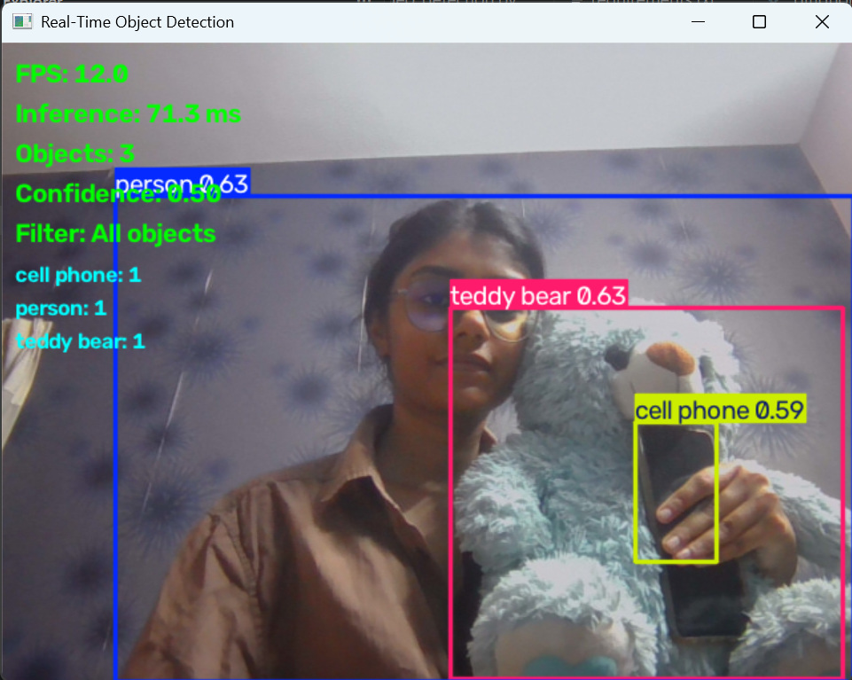

# Real-Time Object Detection using YOLO

A Python-based computer vision project that detects and classifies objects in real time using a webcam, or from existing images and videos. Built with OpenCV and Ultralytics YOLO.

## Features

- **Real-time webcam detection:** Detect objects live using your computer's webcam.
- **Image detection:** Select an image, detect objects, and save the annotated result.
- **Video detection:** Process a video, visualize detections, and export the annotated video.
- **Performance monitoring:** Display FPS, inference time, and detected object counts in webcam mode.
- **Confidence adjustment:** Increase or decrease the detection confidence threshold.
- **Class filtering:** Detect all supported objects, people only, or vehicles only.
- **Unified menu:** Access all three detection modes from one application.

## Demo


## Technologies Used

- Python
- OpenCV
- Ultralytics YOLO
- Computer Vision
- Deep Learning

## Project Structure

```text
real-time-object-detection/
├── main.py
├── webcam.py
├── image_detection.py
├── video_detection.py
├── requirements.txt
├── .gitignore
└── README.md
```

## Installation

### 1. Clone the repository

Replace `YOUR_USERNAME` with your GitHub username.

```bash
git clone https://github.com/khushi-commits-bit/real-time-object-detection.git
cd real-time-object-detection
```

### 2. Create a virtual environment

```bash
py -3.13 -m venv .venv
```

Activate it in Windows PowerShell:

```powershell
.\.venv\Scripts\Activate.ps1
```

If PowerShell blocks activation, run this command in the current terminal session and try again:

```powershell
Set-ExecutionPolicy -Scope Process -ExecutionPolicy Bypass
.\.venv\Scripts\Activate.ps1
```

### 3. Install dependencies

```bash
python -m pip install --upgrade pip
pip install -r requirements.txt
```

### 4. Run the application

```bash
python main.py
```

The application presents a menu for webcam, image, video, or exit. The first run may download the YOLO model weights automatically, so an internet connection is needed for the initial download.

## How to Use

Choose an option from the main menu:

| Option | Function |
|---|---|
| 1 | Webcam detection |
| 2 | Image detection |
| 3 | Video detection |
| 4 | Exit |

### Webcam Controls

| Key | Action |
|---|---|
| `Q` | Quit webcam mode |
| `+` or `=` | Increase confidence threshold |
| `-` or `_` | Decrease confidence threshold |
| `1` | Detect all supported classes |
| `2` | Detect people only |
| `3` | Detect vehicles only |

The webcam display includes an FPS estimate, inference time, total detected objects, confidence threshold, active filter, and per-class counts.

## Model

The application uses the lightweight `yolo26n.pt` model through the Ultralytics library. The model is suitable for experimenting with object detection on images, video, and live webcam feeds.

Detection performance depends on hardware, input resolution, lighting, and the number of objects in a scene.

## Learning Outcomes

This project provides practical experience with:

- Integrating a pretrained object detection model.
- Processing live webcam frames with OpenCV.
- Applying computer vision to images and video streams.
- Displaying bounding boxes, class labels, and confidence scores.
- Measuring inference time and estimating frame rate.
- Organizing a Python project into reusable modules.
- Managing dependencies and version control with Git and GitHub.

## Future Improvements

- Add object tracking across video frames.
- Record detection statistics and export results.
- Create a graphical user interface.
- Benchmark performance across different hardware and model sizes.
- Explore deployment on robotics or edge-computing hardware.

---

**Note:** This project uses a pretrained model. Detection accuracy and performance may vary depending on the input and computing hardware.